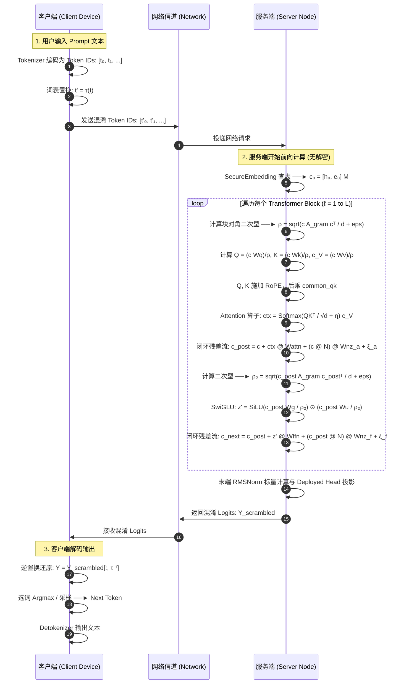

# fastProve 系统技术架构与实现规格说明书

状态：CURRENT
日期：2026-09-16
上游依据：AGENTS.md、docs/architecture.md
适用范围：系统技术架构、模块职责与接口规格（v2.0）

**版本**：v2.0 (部署闭环与增广混淆演进版)  
**更新日期**：2026-09-16  
**对应代码库状态**：Stage A–D 全闭环实现 (`src/fastprove/`)

---

## 1. 系统定位与整体拓扑

`fastProve` 是一个面向 Transformer 大语言模型推理的**增广带噪协变混淆（Augmented Covariant Obfuscation）**研究原型系统。系统面向“端云协同（Client-Server Split Inference）”推理场景：

* **客户端（Client / Edge）**：持有原始输入提示词、词表置换密钥 $\tau$、秘密基分解因子以及解码映射。客户端负责轻量级的 Token 编解码与安全交互，不承担重型矩阵运算。
* **服务端（Server / Cloud）**：持有经过离线转换的混淆模型权重包（`server_model_dir`）。服务端在**不解混（Non-decoding）**的前提下，直接在增广混淆激活状态 $c$ 上执行等价的大规模矩阵乘法、RMSNorm 标量收缩、RoPE 注意力与 SwiGLU 前馈网络，最终输出混淆 Logits。

```
                       【客户端 (可信域 / 本地设备)】
                                   │
              原始输入 Token ──────┼─────► 词表置换 τ
                                   │            │
                                   │            ▼ 混淆 Token ID (c_token)
 ══════════════════════════════════╪════════════╪═════════════════════════
                       【网络传输层 / 唯密文信道】  │
 ══════════════════════════════════╪════════════╪═════════════════════════
                                   │            ▼
                       【服务端 (不可信计算域 / GPU)】
                                   │
                       SecureEmbedding (混淆查表)
                                   │ 混淆初始态 c₀ = [h₀, e₀] M
                                   ▼
                   ┌────────────────────────────────┐
                   │   Deployed Transformer Block   │
                   │                                │
                   │  1. 块对角二次型计算 ρ = rms(h)  │
                   │  2. 离线吸收投影: Q, K, c_V      │
                   │  3. RoPE + 共同正交 Q/K 注意力   │
                   │  4. 闭环残差流: c + Wattn + Wnz │
                   │  5. 块对角二次型计算 ρ₂          │
                   │  6. 神经元置换 SwiGLU + Wffn    │
                   │  7. 闭环残差流: c + Wffn + Wnz  │
                   └───────────────┬────────────────┘
                                   │ 循环 L 层
                                   ▼
                       Deployed LM Head (Untied)
                                   │
                                   ▼ 混淆 Logits (y_scrambled)
 ══════════════════════════════════╪════════════╪═════════════════════════
                       【网络传输层 / 唯密文信道】  │
 ══════════════════════════════════╪════════════╪═════════════════════════
                                   │            ▼
                       【客户端 (可信域 / 本地设备)】
                                   │
              生成明文 Token ◄─────┴───── 逆置换 τ⁻¹ / Argmax
```

### 核心工程原则
1. **在线零解混（No On-line Decode）**：在正式部署执行（`deployed forward`）中，服务端完全不持有逆矩阵 $M^{-1}$，不将状态投影回明文 $h$，不调用任何矩阵求逆算子（严格禁止 `torch.linalg.inv`、`pinv`、`solve`）。
2. **权重离线完全吸收（Offline Weight Absorption）**：基础模型的线性权重、RMSNorm 学习缩放 $\Gamma$、增广混合基 $M$ 以及辅助耦合矩阵在离线转换期预先融合，使得服务端的 GEMM 次数与明文模型严格一致。
3. **代数等价与闭环传递（Algebraic Covariance）**：所有非线性算子（RMSNorm、Softmax、SwiGLU）均设计有保真度证明或有界摄动控制，确保在精确模式下与明文模型输出逐 Token 对齐。

---

## 2. 状态表示与数学基座

### 2.1 基础代数规范与布局
* **符号约定**：全系统采用**行向量数学约定**：
  $$Y = X W + b, \qquad X \in \mathbb{R}^{B \times S \times d_{\rm in}}, \quad W \in \mathbb{R}^{d_{\rm in} \times d_{\rm out}}$$
* **内存布局区分**：
  * 所有数学定义与转换矩阵均采用数学布局 `[in, out]`（张量后缀 `_math`）。
  * PyTorch `F.linear` 底层存储为转置布局 `[out, in]`（张量后缀 `_pt`）。
  * 转换层显式执行 `weight_pt = weight_math.T.contiguous()`，禁止对非方阵做无感转置。

### 2.2 增广混合状态（Augmented Mixed State）
对于隐藏维度 $d$ 的 Transformer，引入辅助噪声维度 $r \ll d$（通常 $r \in \{8, 16\}$），构成总维度 $n = d + r$：
$$z = [h, \; e] \in \mathbb{R}^n, \qquad h \in \mathbb{R}^d, \quad e \in \mathbb{R}^r$$
服务端观察到的混淆状态 $c$ 为增广状态在秘密基 $M$ 下的线性映射：
$$c = z M = [h, \; e] M = h M_{\rm top} + e M_{\rm bot} \in \mathbb{R}^n$$
其中：
* $M_{\rm top} = M_{[:d, :]} \in \mathbb{R}^{d \times n}$（信号基分量）
* $M_{\rm bot} = M_{[d:, :]} \in \mathbb{R}^{r \times n}$（噪声基分量）

### 2.3 信号与噪声读出映射
定义逆基 $M^{-1}$ 的列切片：
$$P = (M^{-1})_{[:, :d]} \in \mathbb{R}^{n \times d}, \qquad N = (M^{-1})_{[:, d:]} \in \mathbb{R}^{n \times r}$$
由 $M M^{-1} = I_n$ 与 $M^{-1} M = I_n$ 的块代数结构，精确成立以下正交与投影恒等式：
$$\begin{cases}
M_{\rm top} P = I_d, & M_{\rm bot} P = 0_{r \times d} \\
M_{\rm top} N = 0_{d \times r}, & M_{\rm bot} N = I_r \\
P M_{\rm top} + N M_{\rm bot} = I_n
\end{cases}$$
**推论**：
* 信号投影：$c P = ([h, e] M) P = h (M_{\rm top} P) + e (M_{\rm bot} P) = h$。
* 噪声投影：$c N = ([h, e] M) N = h (M_{\rm top} N) + e (M_{\rm bot} N) = e$。

### 2.4 矩阵族定义
系统支持两类条件数严格受控的矩阵族（默认 $\kappa_2(M) \le 10$）：

#### 1. 结构化分块基（Structured Basis, 部署主选）
为了将矩阵运算与二次型求值的复杂度从 $O(n^2)$ 压缩至 $O(n \cdot b)$，定义：
$$M = \Pi_1 D B \Pi_2$$
* $\Pi_1, \Pi_2 \in \mathbb{R}^{n \times n}$：全局坐标置换矩阵；
* $D \in \mathbb{R}^{n \times n}$：有界正对角缩放矩阵，满足 $\max(D)/\min(D) = \kappa_2(M) \le 10$；
* $B = \operatorname{diag}(B_1, B_2, \dots, B_m) \in \mathbb{R}^{n \times n}$：块对角正交矩阵，块宽为 $b$（默认 $b=16$），总块数 $m = n/b$；每个子块 $B_k \in \mathbb{R}^{b \times b}$ 满足 $B_k B_k^T = I_b$。

#### 2. 双侧稠密基（Two-sided Dense Basis, Stage A 候选）
$$M = Q_L D Q_R$$
$Q_L, Q_R$ 分别为独立的 $n \times n$ Haar 正交矩阵，$D$ 为对角奇异值矩阵。该矩阵打破了单侧置换结构，具有更均匀的行交叉内积分布。

---

## 3. 部署权重离线吸收机制

在服务端部署路径中，所有线性层和残差更新均被重构为直接在混淆向量 $c$ 上的操作。以下所有恒等式在 `docs/design_identity_check.py` 中经由 FP64 严格验证（残差误差 $\le 3 \times 10^{-14}$）。

### 3.1 Q / K / V 投影权重的离线吸收
明文模型中带学习缩放 $\Gamma = \operatorname{diag}(\gamma)$ 的 Q/K/V 投影计算为：
$$Q = \operatorname{rmsnorm}_0(h) \Gamma W_Q = \frac{h}{\rho} \Gamma W_Q, \qquad \rho = \sqrt{\frac{1}{d}\|h\|^2 + \epsilon}$$
利用 $h = c P$，可将 $P$ 与 $\Gamma W$ 离线结合：

#### 1. Query 部署权重
$$W_q = P \Gamma_a W_Q \in \mathbb{R}^{n \times (H \cdot d_h)}$$
$$\text{在线执行：} \quad Q = \frac{c W_q}{\rho}$$

#### 2. Key 部署权重
$$W_k = P \Gamma_a W_K \in \mathbb{R}^{n \times (H_{kv} \cdot d_h)}$$
$$\text{在线执行：} \quad K = \frac{c W_k}{\rho}$$

#### 3. Value 增广部署权重
Value 向量在每个 KV 头携带局部辅助噪声 $e_V \in \mathbb{R}^{r_h}$，混合基为 $M_V \in \mathbb{R}^{(d_h + r_h) \times (d_h + r_h)}$：
$$W_v^{[head]} = \begin{bmatrix} P \Gamma_a W_V^{[head]} & C_V^{[head]} \end{bmatrix} M_V \in \mathbb{R}^{n \times (d_h + r_h)}$$
$$\text{在线执行：} \quad c_V^{[head]} = \frac{c W_v^{[head]}}{\rho}$$

### 3.2 注意力输出融合与残差流更新
注意力机制计算得到混合上下文：
$$\operatorname{mixed\_ctx} = \operatorname{softmax}(S) c_V \in \mathbb{R}^{B \times S \times H \times (d_h + r_h)}$$
明文残差更新要求：
$$h_{\rm post} = h + \operatorname{ctx} W_O$$
辅助噪声按仿射链式更新：
$$e_{\rm post} = e G_a + (\operatorname{ctx} W_O) C_O + \xi_a$$
混淆目标态为 $c_{\rm post} = [h_{\rm post}, e_{\rm post}] M$。

利用分解 $I_n = P M_{\rm top} + N M_{\rm bot}$，残差流可以直接在混淆域闭环累加：
$$c_{\rm post} = c + \sum_{q\_head} \operatorname{mixed\_ctx}_{[:, :, q]} W_{\rm attn}^{[q]} + (c N) W_{\rm nz\_a} + \xi_{a, \rm out}$$
其中离线融合矩阵定义为：
* **注意力输出投影融合**：
  $$W_{\rm attn}^{[q]} = (M_V^{-1})_{[:, :d_h]} W_O^{[q]} (M_{\rm top} + C_O M_{\rm bot}) \in \mathbb{R}^{(d_h + r_h) \times n}$$
* **残差噪声读出传播权重**：
  $$W_{\rm nz\_a} = (G_a - I_r) M_{\rm bot} \in \mathbb{R}^{r \times n}$$
* **刷新噪声输出**：
  $$\xi_{a, \rm out} = \xi_a M_{\rm bot} \in \mathbb{R}^n$$

### 3.3 SwiGLU 前馈网络离线吸收
明文 SwiGLU 经由神经元共同排列 $P_f \in \mathbb{R}^{d_{ff} \times d_{ff}}$ 与对角缩放 $D_f \in \mathbb{R}^{d_{ff} \times d_{ff}}$ 混淆：
1. **Gate 权重**：$W_g = P \Gamma_f W_{\rm gate} P_f \in \mathbb{R}^{n \times d_{ff}}$
2. **Up 权重**：$W_u = P \Gamma_f W_{\rm up} D_f P_f \in \mathbb{R}^{n \times d_{ff}}$
3. **在线激活**：
   $$\rho_2 = \operatorname{rms\_scale}(c_{\rm post}), \qquad z' = \operatorname{SiLU}\left(\frac{c_{\rm post} W_g}{\rho_2}\right) \odot \left(\frac{c_{\rm post} W_u}{\rho_2}\right)$$
4. **Down 权重离线融合**：
   $$W_{\rm ffn} = P_f^T D_f^{-1} W_{\rm down} (M_{\rm top} + C_d M_{\rm bot}) + C_z M_{\rm bot} \in \mathbb{R}^{d_{ff} \times n}$$
5. **残差更新**：
   $$c_{\rm next} = c_{\rm post} + z' W_{\rm ffn} + (c_{\rm post} N) W_{\rm nz\_f} + \xi_{f, \rm out}$$

---

## 4. 非线性算子的在线混淆实现

### 4.1 无需解码的 RMSNorm 标量计算（Gram 块收缩）
服务端执行 RMSNorm 的核心阻碍在于必须精确获取纯信号范数 $\|h\|^2$，但不能将 $h$ 还原。

#### 1. 数学收敛定理
由于 $h = c P$，纯信号平方范数满足二次型：
$$\|h\|^2 = h h^T = (c P) (c P)^T = c (P P^T) c^T$$
定义信号 Gram 矩阵：
$$A_{\rm gram} = P P^T \in \mathbb{R}^{n \times n}$$
当采用结构化基 $M = \Pi_1 D B \Pi_2$ 时，在输出置换 $\Pi_2$ 坐标系下，**$A_{\rm gram}$ 精确呈现块对角分布**：
$$\widetilde{A}_{\rm gram} = \Pi_2 A_{\rm gram} \Pi_2^T = \operatorname{diag}(A_1, A_2, \dots, A_m), \qquad A_k \in \mathbb{R}^{b \times b}$$

#### 2. 在线高效计算流 ($O(n \cdot b)$ 代价)
```python
# 1. 输出坐标对齐
c_perm = c[..., perm_out]  # [B, S, n]
# 2. 分解为 m 个局部块
c_blocks = c_perm.reshape(*c_perm.shape[:-1], m, b)  # [B, S, m, b]
# 3. 块内二次型收缩 (无需显存物化 n x n 稠密矩阵)
quad = torch.einsum("...mi,mij,...mj->...", c_blocks, gram_blocks, c_blocks)
# 4. RMS 标量计算
rho = torch.sqrt(quad / d + eps)
```

#### 3. 部署期 $\rho$-Noise 扰动（防止单 Token 范数查表）
为了抵御利用第 0 层静态范数指纹查表还原明文 Token（见威胁模型 §5bis.9），生产部署路径在计算得到的纯标量 $\rho$ 上叠加有界高斯/均匀截断扰动：
$$\widehat{\rho} = \rho \cdot (1 + \delta_\rho), \qquad |\delta_\rho| \le \tau_\rho \quad (\text{默认 } \tau_\rho = 10^{-5})$$
*注：exact 校验模式下 $\tau_\rho = 0$。*

### 4.2 RoPE 与多模式安全注意力（Attention Modes）
在计算注意力分数前，对 Query 和 Key 执行旋转位置编码（RoPE）。

#### 1. RoPE 后共同正交变换
为防止注意力计算泄漏绝对坐标，并在多 Query 头共享 KV 头（GQA）时保持兼容，在 RoPE 之后对每个 KV 分组引入正交矩阵 $C_j \in \mathbb{R}^{d_h \times d_h}$：
$$Q'_i = \operatorname{RoPE}(Q_i) C_j, \qquad K'_j = \operatorname{RoPE}(K_j) C_j \quad (\forall i \in \operatorname{group}(j))$$
因为 $C_j C_j^T = I$，点积严格不变：
$$S_{ij} = \frac{Q'_i (K'_j)^T}{\sqrt{d_h}} = \frac{\operatorname{RoPE}(Q_i) C_j C_j^T \operatorname{RoPE}(K_j)^T}{\sqrt{d_h}} = \frac{\operatorname{RoPE}(Q_i) \operatorname{RoPE}(K_j)^T}{\sqrt{d_h}}$$

#### 2. 四种注意力模式规格
```text
┌───────────────────────────┬─────────────────────────────────────────────────────────────┐
│ 模式名称                  │ 数学实现逻辑                                                │
├───────────────────────────┼─────────────────────────────────────────────────────────────┤
│ 1. plaintext              │ A = softmax(S), O = A @ V (明文参考基线)                    │
│ 2. exact                  │ A = softmax(S), O_mixed = A @ c_V (零 logit 噪声，完全协变) │
│ 3. topk_preserving        │ S_noisy = S + η, 其中 ||η||_∞ ≤ min(τ_max, α·Δk / 2)        │
│                           │ 严格锁定 Top-k 注意力集合不发生翻转                         │
│ 4. free_bounded           │ S_noisy = S + η, 其中 ||η||_∞ ≤ τ_max                       │
│                           │ 固定噪声上界，允许部分长尾排序变化                          │
└───────────────────────────┴─────────────────────────────────────────────────────────────┘
```

### 4.3 词表置换与安全输出头（Secure Embedding & Head）
1. **输入端（SecureEmbedding）**：
   * 客户端持有双射置换 $\tau: [0, V) \to [0, V)$。
   * 输入明文 ID $t$ 被转换为置换 ID $t' = \tau(t)$。
   * 服务端持有的 `deployed_embedding` 矩阵行按照 $\tau$ 预先置乱，并已在列方向右乘 $M_0$。查表直接产出混淆态 $c_0 = [E[t], e_0] M_0$。
2. **输出端（Deployed LM Head）**：
   * 针对解绑（Untied）架构，部署权重 $W_{\rm head} = P \Gamma_{\rm final} W_{\rm base\_head} \Pi_\tau$。
   * 服务端输出置乱的 Logits，客户端本地利用 $\tau^{-1}$ 映射恢复标准词表上的概率或执行 Greedy 解码。

---

## 5. 模型转换器与工件包规范 (Converter Specification)

`fastprove.converter.ModelConverter` 负责将明文模型切分为物理隔离的两个独立目录：

```text
fastProve Conversion Output
├── server_model_dir/                     # 【部署包】完全公开给服务节点
│   ├── deployed_weights.pt               # 包含所有 deployed_* 权重、A_gram 块、common_qk
│   ├── runtime_config.json               # 服务端运行时参数 (禁用任何基矩阵参数)
│   └── manifest.json                     # 部署包 SHA-256 校验清单
└── client_secret_dir/                     # 【保密包】仅保留在客户端本地
    ├── client_manifest.json              # 客户端元数据
    ├── token_codec.pt                    # 词表置换 τ 与逆置换 τ⁻¹
    └── basis_factors.pt                  # 仅供离线/调试使用的完整基矩阵与逆矩阵
```

### 5.1 服务端包安全扫描机制（Forbidden Leaf Check）
转换器在输出 `server_model_dir` 前，执行强制的词根扫描。一旦发现以下任一敏感子串作为张量叶名称出现，**立即抛出致命异常并熔断转换**：
```python
_FORBIDDEN_SERVER_KEY_LEAF_TOKENS = (
    "perm_in", "perm_out", "scales", "blocks", "gram",
    "inverse", "rotation", "coupling", "propagator",
    "tau", "token_codec", "basis"
)
```
*注：`common_qk` 与 `deployed_gram_blocks` 属于服务端必须执行的算子依赖，在转换产物的 runtime_config.json 的 `server_visible_key_material` 字段中显式备案，不再进行隐匿。*

---

## 6. 在线推理数据流与交互时序



---

## 7. 数值稳定性策略与工程边界

### 7.1 精度分配规则 (Precision Governance)
1. **离线高精（Offline FP64）**：所有基矩阵随机生成、正交 QR 分解、矩阵求逆、条件数校验与部署权重乘法均在 **CPU FP64** 下计算，杜绝离线舍入误差引入病态基。
2. **敏感统计高精（FP32 Reductions）**：
   * RMS 二次型计算、均值求和、开方及除法必须在 **FP32** 下执行；
   * Softmax Logit 缩放、掩码判定、Margin 计算与 Exponent 必须在 **FP32** 下执行；
   * 严禁在 RMS 标量聚合中使用 BF16。
3. **激活与权重类型（Configurable Dtype）**：前向主干 GEMM 支持 FP32 与 BF16。

### 7.2 核心工程约束与硬指标
* **辅助噪声幅度硬约束**：
  $$\frac{\|e\|}{\|h\|} \le 30$$
  *原因：$A_{\rm gram}$ 的 FP32 截断误差随 $(\|e\|/\|h\|)^2$ 增长。超过 30 将直接造成信号路径 $\rho$ 精度漂移，导致模型输出坍塌（见 `tests/math/test_structured_basis.py`）。*
* **基条件数约束**：$\kappa_2(M) \le 10$。
* **显存膨胀控制**：
  * 主干 Transformer 维度膨胀率为 $n/d = (d+r)/d$（当 $d=3072, r=16$ 时，膨胀率仅 **0.52%**）。
  * 词表解绑（Untied Head）在 3B 规模下带来约 **+0.79 GB** 显存增量。

---

## 8. 技术文档索引与关联导引

* **数学恒等式独立复核预言机**：[`docs/design_identity_check.py`](design_identity_check.py)
* **已知安全性上界与泄漏清单**：[`docs/PROBLEMS.md`](PROBLEMS.md)
* **端云威胁模型与特权边界**：[`docs/threat_model.md`](threat_model.md)
* **交接与阶段性审计备忘录**：[`docs/archive/2026-09-15_AUGMENTED_NOISE_HANDOFF_20260915.md`](archive/2026-09-15_AUGMENTED_NOISE_HANDOFF_20260915.md)
* **评测与实验实施方案**：[`docs/archive/2026-09-19_experiment_plan.md`](archive/2026-09-19_experiment_plan.md)
